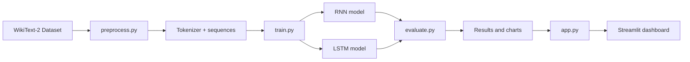

# Next Word Prediction System Using RNN and LSTM

## Project title
Next Word Prediction System Using RNN and LSTM

## Project overview
This project builds a next-word prediction system that compares a Simple RNN and an LSTM model trained on the WikiText-2 raw dataset. It includes text preprocessing, tokenization, training, evaluation, prediction, and a polished Streamlit user interface.

## Problem statement
Language modeling is the task of predicting the most likely next token based on context. Recurrent architectures such as RNN and LSTM are natural fits for this task.

## Objectives
- Download and preprocess the WikiText-2 raw dataset.
- Train both a Simple RNN and an LSTM on the same data.
- Evaluate and compare accuracy, loss, and perplexity.
- Build a user-facing app that predicts next words from custom text.

## Features
- Automatic dataset download from Hugging Face.
- Keras tokenizer with OOV handling.
- Fixed-length sequence generation for next-word prediction.
- Comparable RNN and LSTM training pipelines.
- Training curves and evaluation plots.
- Streamlit interface for prediction and comparison.

## Technologies used
- Python 3.11
- TensorFlow / Keras
- NumPy
- Pandas
- Matplotlib
- Streamlit
- Hugging Face Datasets
- Pickle
- Git and GitHub

## Dataset information and source
Dataset: Salesforce WikiText-2 raw
Dataset identifier: `Salesforce/wikitext`
Dataset config: `wikitext-2-raw-v1`
Source: https://huggingface.co/datasets/Salesforce/wikitext

## Dataset licensing and attribution
Follow the dataset card and licensing terms on the official Hugging Face page. This project uses the dataset according to the platform-provided license and attribution requirements.

## RNN architecture
Architecture:
Embedding -> SimpleRNN -> Dropout -> Dense Softmax

## LSTM architecture
Architecture:
Embedding -> LSTM -> Dropout -> Dense Softmax

## System architecture diagram


## Project directory structure
```text
next-word-prediction/
├── app.py
├── ui_common.py
├── ui_pages/
│   ├── 1_Next_Word_Prediction.py
│   ├── 2_Sentence_Continuation.py
│   ├── 3_Model_Comparison.py
│   ├── 4_Performance_Dashboard.py
│   └── 5_About.py
├── train.py
├── preprocess.py
├── predict.py
├── evaluate.py
├── config.py
├── requirements.txt
├── README.md
├── .gitignore
├── LICENSE
├── .streamlit/
│   └── config.toml
├── data/
│   ├── README.md
│   ├── .gitkeep
│   └── wikitext2/
│       ├── train.txt
│       ├── valid.txt
│       ├── test.txt
│       ├── processed_*.npz
│       └── preprocessing_metadata.json
│   └── demo_v3/
│       ├── processed_*.npz
│       └── preprocessing_metadata.json
├── models/
│   ├── README.md
│   ├── .gitkeep
│   └── wikitext2/
│       ├── tokenizer.pkl
│       ├── rnn_model.keras
│       └── lstm_model.keras
│   └── demo_v3/
│       ├── tokenizer.pkl
│       └── experiments/
│           ├── A/best_model.keras
│           ├── B/best_model.keras
│           ├── C/best_model.keras
│           └── D/best_model.keras
├── results/
│   ├── README.md
│   ├── .gitkeep
│   ├── demo_v3/
│   │   ├── metrics.json
│   │   ├── model_comparison.png
│   │   └── experiments/
│   └── wikitext2/
│       ├── training_history.json
│       ├── metrics.json
│       └── *.png
├── tests/
│   ├── test_preprocessing.py
│   ├── test_prediction.py
│   └── test_models.py
└── .venv/
```

## Installation instructions
```bash
cd next-word-prediction
py -3.11 -m venv .venv
# Windows PowerShell:
.\.venv\Scripts\Activate.ps1
# Linux/macOS: python3.11 -m venv .venv && source .venv/bin/activate
pip install -r requirements.txt
```

## Dependency installation
```bash
pip install -r requirements.txt
```

`requirements.txt` contains only the Streamlit inference/runtime dependencies and pins the tested TensorFlow, NumPy, Matplotlib, and Streamlit versions. Use Python 3.11 for local and Streamlit Community Cloud deployments. Preprocessing/training and tests require their additional packages:

```bash
pip install -r requirements-training.txt
# For running the tests as well:
pip install -r requirements-dev.txt
```

The app loads prepared model/tokenizer artifacts only. Dataset preparation downloads WikiText-2 when explicitly run; normal Streamlit startup does not access Hugging Face or require its local cache.

## Dataset preparation
```bash
python preprocess.py
```

Preprocessing downloads `Salesforce/wikitext` (`wikitext-2-raw-v1`), retains the official train/validation/test splits, and fits the tokenizer on the training split only. By default it processes all rows. For a limited run, set per-split example caps:

```bash
python preprocess.py --max-train-samples 2000 --max-valid-samples 500 --max-test-samples 500
```

WikiText-2 outputs are isolated in `data/wikitext2/` and `models/wikitext2/`; the existing smoke-test artifacts in the legacy locations are left untouched. If those real-dataset preprocessing outputs already exist, preprocessing stops unless explicitly run with `--overwrite`.

## Lightweight WikiText-2 demo
The demo is prepared from the already-downloaded full WikiText-2 raw split files. It selects a deterministic prefix from each official split by generated sequence count, fits its own tokenizer on demo training text only, and writes exclusively to `data/demo/`, `models/demo/`, and `results/demo/`.

```bash
python preprocess.py --demo --demo-train-sequences 20000 --demo-valid-sequences 10000 --demo-test-sequences 10000
```

Demo outputs are protected from accidental overwrite. `--overwrite-demo` replaces only demo artifacts. The full WikiText-2 dataset, tokenizer, and model checkpoints are not touched.

## Model training
```bash
python train.py
```

Training saves the best checkpoint for each model, selected by validation loss, in `models/wikitext2/`. RNN history/checkpoint are persisted before LSTM training begins, so an LSTM failure does not discard completed RNN work. Existing WikiText-2 checkpoints are protected; `--overwrite` is required to replace them.

After reviewing the prepared demo data, train only the demo artifact set with:

```bash
python train.py --artifact-set demo
```

This uses the same configured RNN/LSTM architectures and identical demo training/validation arrays. Its models and histories are stored separately under `models/demo/` and `results/demo/`.

## Demo V2
Demo V2 uses deterministic randomized record-level selection within each official split, fits an uncapped tokenizer on the selected training text only, and derives the model output dimension from that tokenizer. Its data, tokenizer/metadata, independent model checkpoints, and histories are isolated under `data/demo_v2/`, `models/demo_v2/`, and `results/demo_v2/`.

Prepare Demo V2 without replacing existing artifacts:

```bash
python preprocess.py --demo-v2 --demo-train-sequences 20000 --demo-valid-sequences 10000 --demo-test-sequences 10000
```

Demo V2 training is separately invoked after review and uses up to 20 epochs with the existing validation-loss callbacks:

```bash
python train.py --artifact-set demo_v2
```

Evaluate Demo V2 after training with `python evaluate.py --artifact-set demo_v2`. These commands do not overwrite Demo V1, full WikiText-2, or synthetic artifacts.

## Demo V3
Demo V3 is the Streamlit application's active runtime artifact set. It uses the official WikiText-2 Raw train/validation/test splits and a shared Unicode-aware normalization/tokenization pipeline for preprocessing and inference. Its tokenizer is trained only on selected V3 training sequences; the ordered mapping hash and preprocessing metadata are saved under `models/demo_v3/`. Model inputs and results are isolated under `data/demo_v3/`, `models/demo_v3/`, and `results/demo_v3/`.

To reproduce preprocessing from the already downloaded WikiText-2 files:

```bash
python preprocess.py
python demo_v3_preprocess.py
```

The four controlled experiments are A (SimpleRNN, unmasked), B (LSTM, unmasked), C (SimpleRNN, masked), and D (LSTM, masked). They share the V3 tokenizer, arrays, 128-dimensional embeddings, 64 hidden units, 0.2 dropout, Adam, sparse categorical crossentropy, batch size 128, and up to 20 epochs with early stopping and learning-rate reduction. To reproduce training and evaluation, run:

```bash
python train_demo_v3_experiments.py
```

The experiment script requires prepared V3 artifacts and refuses to replace existing experiment outputs. It writes one checkpoint and history per experiment, then updates `results/demo_v3/metrics.json`, charts, and the training report. The Streamlit app itself never runs this command.

The verified comparison for the current saved run is:

| Experiment | Test loss | Top-1 | Top-5 | Perplexity | Training time | Model size |
|---|---:|---:|---:|---:|---:|---:|
| A · SimpleRNN, unmasked | 6.9816 | 11.33% | 24.72% | 1076.67 | 60.21 s | 21.36 MB |
| B · LSTM, unmasked | 7.0809 | 8.98% | 20.66% | 1189.09 | 47.59 s | 21.78 MB |
| C · SimpleRNN, masked | 7.1171 | 11.07% | 24.65% | 1232.91 | 58.47 s | 21.36 MB |
| D · LSTM, masked | 7.1042 | 9.00% | 21.48% | 1217.02 | 49.12 s | 21.78 MB |

These are saved results for this experiment, not universal architecture claims. A is the best overall model by test loss, top-1, and top-5. Masking did not improve test loss in this run.

## Model evaluation
```bash
python evaluate.py --artifact-set wikitext2
```

Use `python evaluate.py --artifact-set demo` for the demo checkpoints or `python evaluate.py --artifact-set synthetic` for the earlier smoke-test artifacts.

## Local Streamlit execution
```bash
streamlit run app.py
```

The prediction and sentence-continuation pages default to the four **Demo V3** checkpoints and V3 tokenizer, with a selector that keeps the original Demo V2 RNN/LSTM artifacts available. Model comparison and the dashboard display Demo V3 results. The application does not download data, preprocess datasets, or train models at startup.

Sentence continuation supports Greedy Decoding, Top-K Sampling, and Temperature-based Sampling. Generation exposes temperature, top-K, length, and repetition-penalty controls. Repetition penalties adjust the model's sampling distribution without excluding vocabulary words outright.

## Streamlit Community Cloud deployment instructions
1. Push the project to a GitHub repository and open Streamlit Community Cloud.
2. Select the repository and branch, set the app file to `app.py`, and use Python 3.11.
3. Keep `requirements.txt`, `.streamlit/config.toml`, the Python source, and the Demo V3 runtime artifacts in the repository.
4. Include these files at their configured paths:
   - `models/demo_v3/tokenizer.pkl`
   - `models/demo_v3/preprocessing_metadata.json`
   - `models/demo_v3/experiments/A/best_model.keras`
   - `models/demo_v3/experiments/B/best_model.keras`
   - `models/demo_v3/experiments/C/best_model.keras`
   - `models/demo_v3/experiments/D/best_model.keras`
   - `results/demo_v3/metrics.json`
   - `results/demo_v3/model_comparison.png`
   - `results/demo_v3/experiments/{A,B,C,D}/training_history.json`
   - `results/demo_v3/training_duration_comparison.png`
   - `results/demo_v3/training_curves.png`
5. Model and tokenizer files may be excluded by `.gitignore`; explicitly include the approved Demo V3 runtime artifacts, for example:

   ```bash
   git add -f models/demo_v3/tokenizer.pkl models/demo_v3/preprocessing_metadata.json
   git add -f models/demo_v3/experiments/A/best_model.keras models/demo_v3/experiments/B/best_model.keras
   git add -f models/demo_v3/experiments/C/best_model.keras models/demo_v3/experiments/D/best_model.keras
   git add results/demo_v3/metrics.json results/demo_v3/model_comparison.png
   git add results/demo_v3/experiments/A/training_history.json results/demo_v3/experiments/B/training_history.json
   git add results/demo_v3/experiments/C/training_history.json results/demo_v3/experiments/D/training_history.json
   ```

   The prediction and continuation pages also offer Demo V2. To keep those options functional in the deployment, include `models/demo_v2/tokenizer.pkl`, `models/demo_v2/rnn/rnn_model.keras`, and `models/demo_v2/lstm/lstm_model.keras`. The ignore rules allow these named runtime artifacts, but they are not required for Demo V3 inference.
   
   Each current V3 checkpoint is about 21.4–21.8 MiB, below GitHub's 100 MB per-file limit. Git LFS is optional for these files, but may be used to reduce regular Git clone history growth. If hosted elsewhere, the app would need an explicit, reliable artifact-download mechanism; it currently expects the files at the repository-relative paths above.
6. Raw WikiText-2 files, preprocessed arrays, Demo V1/V2, full-dataset and synthetic model artifacts are not needed at runtime and should not be included in the deployment package.

The app validates model output dimensions, padding-mask configuration, tokenizer vocabulary size, and the ordered tokenizer mapping hash. If a required runtime file is absent, it displays the expected artifact path. No dataset downloads, training, or external prediction APIs are used by the app.

## GitHub upload instructions
```bash
git init
git add .
git commit -m "Initial project setup"
git branch -M main
git remote add origin <your_repo_url>
git push -u origin main
```

## Screenshots
Add screenshots for the Home page, comparison page, and dashboard after running the app locally.

## Results table
The current saved Demo V3 comparison is listed above. Other artifact sets produce their own metrics when their training and evaluation workflows are run; do not treat the Demo V3 values as results for other checkpoints.

| Model | Test Loss | Top-1 Accuracy | Top-5 Accuracy | Perplexity | Training Time |
|------|-----------|----------------|----------------|------------|---------------|
| Demo V3 A · SimpleRNN, unmasked | 6.9816 | 11.33% | 24.72% | 1076.67 | 60.21 s |
| Demo V3 B · LSTM, unmasked | 7.0809 | 8.98% | 20.66% | 1189.09 | 47.59 s |
| Demo V3 C · SimpleRNN, masked | 7.1171 | 11.07% | 24.65% | 1232.91 | 58.47 s |
| Demo V3 D · LSTM, masked | 7.1042 | 9.00% | 21.48% | 1217.02 | 49.12 s |

## Limitations
- Full WikiText-2 training may require significant time and compute.
- Local experimentation may require a subset or synthetic dataset for smoke testing.
- Large trained model files may not be practical for direct GitHub uploads.

## Future improvements
- Add GPU training and larger vocabulary support.
- Explore transformer-based alternatives.
- Add more advanced evaluation metrics and deployment packaging.

## Conclusion
This project presents a full academic workflow for next-word prediction using RNN and LSTM models, with a clean deployment-ready application.

## Author section
Name: <Your Name>
College: <Your College Name>

## License
This project is distributed under the MIT License. See the LICENSE file for details.

## Deployment notes
- `app.py` is the entry point for Streamlit Community Cloud.
- Relative paths are used for data, models, and results.
- The application should not retrain models automatically on startup.
- If trained model files are missing, the app will show a clear setup message.
